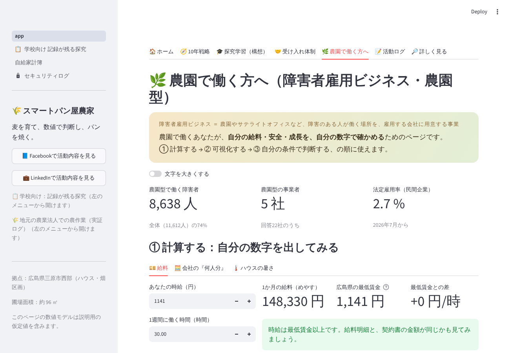

# スマートパン屋農家 ― 記録が残る、農×食×AIの学びの場

**▶ 公開ダッシュボード：<https://smart-bakery-farm.streamlit.app/>**
**▶ 表紙ページ：<https://nayukaya3-cn.github.io/Smart-Bakery-Farmer_20260923/>**

広島県三原市西部の畑とハウスで、パン用小麦（ミナミノカオリ）の栽培からパンづくりまでを、
**「① 現象を計算する → ② 数値を可視化する → ③ 自分の条件で判断する」** の3段構えで記録しています。
どのページも同じ骨格なので、学校の探究学習にも、職場の作業設計にも、そのまま使えます。

## どなた向けか

| どなた向け | まず見てほしいページ | わかること |
|---|---|---|
| 🎓 **特別支援学校・通信制高校の先生** | 📋 記録が残る探究 ／ ⚖️ 比べて確かめる探究 | ルーブリック（5観点×4段階）、活動ログ、学校に出せる実施報告書の例 |
| 🏢 **障害者雇用・特例子会社のご担当者** | 🖨️ 3Dプリンター（自助具） ／ 🤝 福祉×生成AI ／ ホームの「🌿 農園で働く方へ」 | 作業の切り出しと治具化、やさしい手順書、暑さ指数など働く人の安全の見える化 |
| 🧑‍🎓 **探究学習・総合型選抜に取り組む生徒** | 📝 共通テスト理科×情報Ⅰ ／ 🎮 探究コーナー | Google Colab で動く例題、衛星データ・異常検知・微生物の探究テーマ |

## 運営しているのは

- 特別支援学校 高等部で **作業学習（農業・食品加工）の支援を5年4か月**
- **職業訓練指導員（パン・菓子科）**、高等学校教諭一種免許（理科）、情報科免許を取得予定
- 産業用ロボット特別教育を修了、3Dプリンターによる自助具づくりに取り組み中

## いまの段階（正直にお伝えします）

- 現在は **準備・実証の段階** です。本格的な受け入れは **2029年ごろ** を予定しています。
- ダッシュボードの記入例の一部は **架空の例** です（画面にその旨を表示しています）。実施実績ではありません。
- 生徒・利用者の個人情報や写真は掲載しません。記録はサーバーに残らない設計です。

## 連絡・最新の活動

- LinkedIn：<https://www.linkedin.com/in/%E9%9A%86%E8%A6%8F-%E6%A5%A0%E9%A6%99%E8%B0%B7-392aa12a0/>
- Facebook：<https://www.facebook.com/profile.php?id=100079624235158>

見学・職場体験・研修のご相談は、上のどちらかからメッセージをお送りください。

---

開発者・運営者向けの情報（起動手順・ファイル構成・各ページの中身・更新方法）は
**[docs/MANUAL.md](docs/MANUAL.md)** に、セキュリティの方針は **[SECURITY.md](SECURITY.md)** にまとめています。
