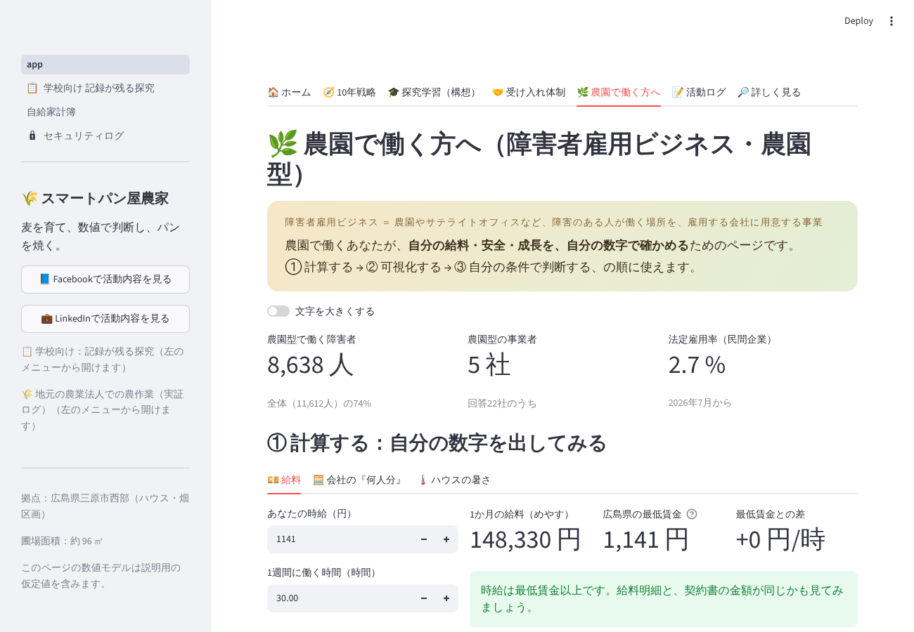

# スマートパン屋農家 ― 記録が残る、農×食×AIの学びの場

**▶ 公開ダッシュボード：<https://smart-bakery-farm.streamlit.app/>**
**▶ 表紙ページ：<https://nayukaya3-cn.github.io/Smart-Bakery-Farmer_20260923/>**

広島県三原市西部の畑とハウスで、パン用小麦（ミナミノカオリ）の栽培からパンづくりまでを、
**「① 現象を計算する → ② 数値を可視化する → ③ 自分の条件で判断する」** の3段構えで記録しています。
どのページも同じ骨格なので、学校の探究学習にも、職場の作業設計にも、そのまま使えます。

## 学校の先生へ：このダッシュボードの立場

> **「科学と人間生活」は、「総合的な探究の時間（探究学習）」におけるフィールドワークの事前学習として、極めて親和性が高く、非常に有益な科目である。**

教科の知識をレンズ（眼鏡）として掛けてから畑に来ると、風車も発酵肥料の湯気も「問いの種」に変わります。
そこで、フィールドワークの前後を、パン工場の衛生管理（HACCP）と同じ骨格の PDCA で一続きに伴走します
（ページ：🧭 **フィールドワーク伴走**）。

| 段 | PDCA | HACCPの言葉 | 先生がすること | 画面で出てくるもの |
|---|---|---|---|---|
| ❶ 事前学習 | P | **HA（危害分析）**＝全体最適 | 単元と調査地を紐付け、「見学で終わる・事故になる」原因を点数化 | 問いのブリッジ表、リスクマップ、**戦略情報メモ**（Markdown） |
| ❷ 日々の伴走 | P→D | 前提条件の整備 | 本番から逆算して1日1課題。記録から声かけの順を決める | 逆算スケジュール、**準備度のベイズ推定**（Beta分布）、声かけ例 |
| ❸ 本番支援 | D | **CCP（重要管理点）**＝臨機応変 | アレルゲン・暑さ指数・機械・問いの質・情報の妥当性・写真の6点だけを基準で測る | CCP管理表、WBGTの判断、当日の管理記録（是正の書き忘れを検出） |
| ❹ 事後学習 | C | 検証＝未来最適 | 事前の予想と現地の事実の「ずれ」を数える | インサイト点、単元別の集計、事前・事後の自己評価 |
| ❺ 次の一手 | A | **是正処置** | ずれの種類ごとに次の探究を提案し、4週間伴走 | 班ごとの**提案書**（Markdown）、伴走の予定 |

事前学習ワークシートとインタビュー質問集も、このページからそのままダウンロードできます。

## どなた向けか

| どなた向け | まず見てほしいページ | わかること |
|---|---|---|
| 🏫 **高校で「総合的な探究の時間」を担当する先生** | 🧭 フィールドワーク伴走 ／ ⚖️ 比べて確かめる探究 | 科学と人間生活を事前学習にしたHACCP型PDCA（❶〜❺）、ワークシート・質問集・CCP管理表・次の一手の提案書 |
| 🎓 **特別支援学校・通信制高校の先生** | 📋 記録が残る探究 ／ ⚖️ 比べて確かめる探究 ／ 🧩 AI×特別支援教育・訓練 | ルーブリック（5観点×4段階）、活動ログ、学校に出せる実施報告書の例、実習の工程分担・生成AIの手順カード・伸びの記録（ベイズ） |
| 🏢 **障害者雇用・特例子会社のご担当者** | 🖨️ 3Dプリンター（自助具） ／ 🤝 福祉×生成AI ／ ホームの「🌿 農園で働く方へ」 | 作業の切り出しと治具化、やさしい手順書、暑さ指数など働く人の安全の見える化 |
| 🧭 **就活・起業・学び直しを考えている方** | 🧭 AI時代に残る仕事（就活と起業） ／ 🍅 ハウス収穫ロボ体験実習 | 置き換わりにくさの計算（タスク分解）、資格と経験の前提の地図、応募数のベイズ計算、出張講習の損益分岐 |
| 🧑‍🎓 **探究学習・総合型選抜に取り組む生徒** | 📝 共通テスト理科×情報Ⅰ ／ 🎮 探究コーナー | Google Colab で動く例題、衛星データ・異常検知・微生物の探究テーマ、ハウス収穫ロボのシミュレーター（人とAIの収穫を比べる体験実習）、除草AIロボのシミュレーター（🤖 AIロボット（見回り・除草の体験）：人の目・AIだけ・AI＋人で雑草を取り比べる） |

## 運営しているのは

- 特別支援学校 高等部で **作業学習（農業・食品加工）の支援を5年4か月**
- **職業訓練指導員（パン・菓子科）**、高等学校教諭一種免許（理科）、情報科免許を取得予定
- 産業用ロボット特別教育を修了、3Dプリンターによる自助具づくりに取り組み中

## いまの段階（正直にお伝えします）

- 現在は **準備・実証の段階** です。本格的な受け入れは **2029年ごろ** を予定しています。
- ダッシュボードの記入例の一部は **架空の例** です（画面にその旨を表示しています）。実施実績ではありません。
- 生徒・利用者の個人情報や写真は掲載しません。記録はサーバーに残らない設計です。

## 連絡・最新の活動

- LinkedIn：<https://www.linkedin.com/in/%E9%9A%86%E8%A6%8F-%E6%A5%A0%E9%A6%99%E8%B0%B7-392aa12a0/>
- Facebook：<https://www.facebook.com/profile.php?id=100079624235158>

見学・職場体験・研修のご相談は、上のどちらかからメッセージをお送りください。

---

開発者・運営者向けの情報（起動手順・ファイル構成・各ページの中身・更新方法）は
**[docs/MANUAL.md](docs/MANUAL.md)** に、セキュリティの方針は **[SECURITY.md](SECURITY.md)** にまとめています。
